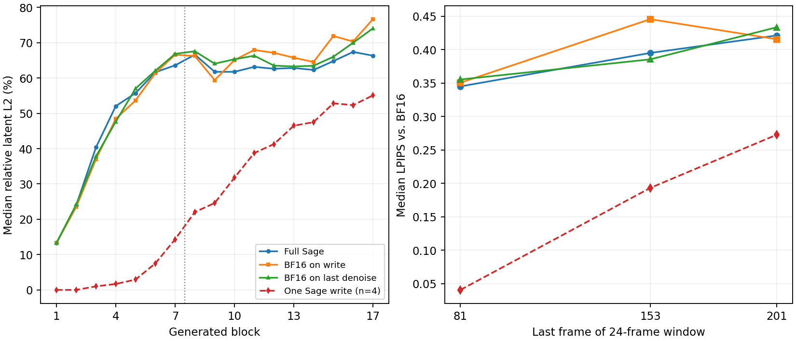

# Self Forcing 的 201 帧对照实验

在单张 RTX 4090 上，四步 Self Forcing 生成 201 帧时，全 SageAttention 用时 32.51 秒，原生 BF16 用时 38.32 秒，加速 1.18×。只在第 2 块的历史写回使用一次 Sage，也会影响 12.6 秒视频的末段。写回保留 BF16 在部分样例中保住了人物特征，8 组配对尚不足以确定一个普遍的画质失效帧数或最优精度策略。

## 速度与整段视频质量

| 缓存自注意力策略 | 热样本生成耗时 | 加速比 | 主体一致性 ↑ | 检出明显运动 | 成像质量 ↑ | 末 24 帧 LPIPS ↓ | 末 24 帧 PSNR ↑ |
|---|---:|---:|---:|---:|---:|---:|---:|
| 全原生 BF16 | 38.32 秒 | 1.00× | 0.8835 | 7/8 | 0.6199 | 0 | ∞ |
| 全 Sage | 32.51 秒 | 1.18× | 0.8878 | 7/8 | 0.6215 | 0.4213 | 14.90 dB |
| 每块仅历史写回用 BF16 | 33.80 秒 | 1.13× | 0.8901 | 7/8 | 0.6235 | 0.4157 | 13.75 dB |
| 每块仅末次去噪用 BF16 | 33.78 秒 | 1.13× | 0.8884 | 7/8 | 0.6148 | 0.4336 | 14.08 dB |

速度取 6 个热样本的中位数。只看与 81 帧首轮相同的三条热提示词，原生和全 Sage 分别为 38.28 和 32.46 秒，仍是 1.18×。81 帧首轮的对应值为 17.55 和 12.58 秒，即 1.40×。长视频的两种混合策略都比全 Sage 多用约 1.3 秒。四种策略的热样本峰值已分配显存均约 13.0 GiB。[四策略汇总](summary/policies.csv) · [每条视频的计时与质量](summary/videos.csv)

主体一致性和成像质量是 8 组提示词与种子上的均值，动态程度为 VBench 的逐视频二元判定。四种策略均只有雪地猛犸未达到其明显运动阈值。LPIPS 衡量感知特征距离，PSNR 衡量像素差异，二者均用同提示词、同种子的 BF16 视频作参照。表中取各视频末 24 帧结果的中位数。成像质量与主体一致性评估视频本身，和对原生轨迹的保真度可以有不同排序。[逐窗口测量](summary/windows.csv) · [VBench 成像质量实现](https://github.com/Vchitect/VBench/blob/1039fe66d7aa2f4b214003ca2d35f5011c48bfee/vbench/imaging_quality.py)

## 一次写回的影响能持续多久

四条首轮提示词上，仅将第 2 块生成完毕后的干净历史写回换成 Sage。四条的前两块潜变量均与原生逐元素相同。第 3 块首次出现差异，随后误差总体增大。每个窗口容纳 7 块，第 9 块开始时，受干预的第 2 块已经被挤出，后续生成仍携带此前的差异。[逐块原始测量](summary/chunks.csv)

| 观察位置 | 第 3 块 | 第 7 块（81 帧） | 第 9 块 | 第 13 块（153 帧） | 第 17 块（201 帧） |
|---|---:|---:|---:|---:|---:|
| 单次写回后的相对潜变量 L2，中位数 | 1.01% | 14.33% | 24.59% | 46.49% | 55.08% |
| 对应末 24 帧 LPIPS，中位数 | — | 0.041 | — | 0.193 | 0.273 |
| 对应末 24 帧 PSNR，中位数 | — | 27.66 dB | — | 18.74 dB | 18.14 dB |

全 Sage 的 8 组样例在 81、153、201 帧三个位置的末段 LPIPS 分别为 0.345、0.395、0.421。下图左侧的灰线表示缓存开始滚动的位置。一次写回干预使用 4 条提示词，其余曲线使用 8 组提示词与种子。[各检查位置汇总](summary/trends.csv)

## 可见失真与样例差异

乒乓球提示词明确写了一名白衣球员和一名黑衣球员。种子 2027 的全 Sage 在第 177、201 帧已呈现两名深色上衣球员，同一位置的写回 BF16 仍可分辨白衣与黑衣。全 Sage 的末段主体一致性仍有 0.829，略高于原生的 0.815，说明这个分数可以漏掉提示词指定的服装变化。种子 2026 的全 Sage 在第 201 帧仍保留黑白两种球衣。[两种子的对照图一](summary/previews/2027-table-tennis.jpg) · [对照图二](summary/previews/2026-table-tennis.jpg) · [全 Sage 原视频](seed-2027/sage/videos/1-0_ema.mp4) · [写回 BF16 原视频](seed-2027/native_write/videos/1-0_ema.mp4)

东京街景在第 153 帧附近的四种策略中都从暖色店面转入强烈的紫红色霓虹。两种子的赛车在末段仍可辨认红色车身，车位与视角已分开。全原生的主体一致性也从第 81 帧末段的 0.9015 降至第 201 帧末段的 0.8213。只看后段变色或主体分数下降，会把镜头变化和模型本身的长时漂移算进量化损失。[东京街景](summary/previews/2026-tokyo.jpg) · [赛车种子 2026](summary/previews/2026-rally.jpg) · [赛车种子 2027](summary/previews/2027-rally.jpg)

给每块相同的一次 BF16 预算，写回方案的末段 LPIPS 在 8 组中的 5 组更低。逐对计算“写回减末次去噪”，中位差为 −0.0054。赛车和乒乓球各自换种子后，两种方案的末段 LPIPS 排序都反转。现有证据足以说明写回误差能跨出缓存窗口，也给出了具体的服装变化样例。判断这种保护作用出现的频率，还需要更多独立样例和对提示词指定属性的评价。[八组配对差值](summary/paired-tail.csv) · [全部八张对照图](summary/previews)

## 复现口径

- 生成和评估均在远端独立工作树 `${PROJECT_ROOT}`。使用冻结的官方四步 DMD EMA 权重、SageAttention 1.0.6、832×480、16 fps、batch 1。每块 3 个潜帧，每段 51 个潜帧，解码为 201 帧。四个策略共用作者已有的 21 潜帧滚动缓存，保留最近 7 块，`sink_size=0`。首轮 81 帧正好用满同样大小的缓存。[配置](long.yaml) · [设备和核心依赖](environment.txt) · [模型版本](provenance/models.txt) · [Self Forcing 作者的长视频示例](https://self-forcing.github.io/)
- 种子 2026 用作者提示词列表的第 1–4、68、347 行，分别为东京街头、猛犸、宇航员、海岸、拉力赛车、双人乒乓球。两条压力提示词另跑种子 2027。四种策略在每个种子组内用同样的提示词顺序与随机流，种子 2027 反转四个策略的运行次序。另有四段单次写回干预，总计 36 段视频。[种子 2026 提示词](seed-2026/prompts.txt) · [种子 2027 提示词](seed-2027/prompts.txt) · [生成命令](provenance/run_length.sh)
- 计时从提示词编码到 VAE 解码，包含期间的搬运，排除模型加载与视频写盘。各策略每个种子单独起进程，该进程第一条仅参与质量评估。长度比较取同一条 201 帧视频在第 81、153、201 帧处的等长末 24 帧，以及相应视频块的潜变量。独立运行的 81 帧首轮仅作计时对照，改变生成长度会改变随机数消耗顺序。
- LPIPS 使用 AlexNet v0.1，在原分辨率上逐帧计算。PSNR 先汇总每个窗口的 RGB 均方误差，再转换成 dB。VBench 使用 DINO 主体一致性、RAFT 动态程度、MUSIQ-SPAQ 成像质量。末段主体一致性沿用整段首帧锚点和相邻帧，成像质量以 0–1 表示。图像核对取每条第 1、41、81、117、153、177、201 帧，属于抽帧观察。[逐帧数据](summary/frames.csv) · [评估实现](provenance/score_length.py) · [汇总实现](provenance/summarize_length.py)

远端结果目录为 `runs/length-201-20261124`。本地这份结果包含 36 段 MP4、36 份潜变量、612 个视频块和 7,236 个逐帧记录。首轮评估算齐后，作图因缺少 Matplotlib 退出。补齐项目内依赖后直接从已保存的逐例记录完成绘图和汇总，生成、评分与汇总最终均退出 0。[生成日志](driver.log) · [首轮评估日志](attempts/plot-dependency/analysis.log) · [完成记录](analysis.log)
